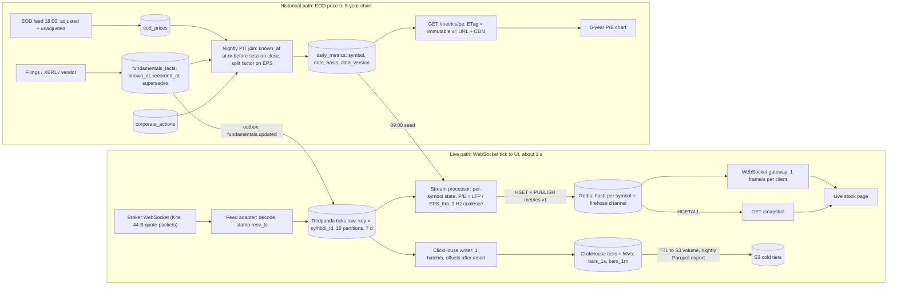

# Multi-Frequency Financial Data Platform

## Summary of the stack

I would run two databases, each doing one thing well. Redpanda buffers ticks for replay. A Python stream processor writes one snapshot per symbol per second into Redis. ClickHouse stores raw ticks and OHLC bars, with compression and S3 tiering declared in DDL. PostgreSQL owns everything small that must be exactly right: the append-only fundamentals ledger, corporate actions, EOD prices and the precomputed daily metrics behind every chart. The load is modest; the hard part is the `known_at` ledger and the invalidation rules, both enforced in Postgres.

| Layer | Technology | Why |
|---|---|---|
| Ingest bus | Redpanda (Kafka API), 16 partitions keyed by symbol, 7-day retention | Durable replay of whole sessions; per-symbol ordering; one binary, no JVM |
| Live compute | Python asyncio + aiokafka, one process per partition group | State is a dict per symbol; nothing to cluster at ~1 MB/s |
| Hot snapshot | Redis 7: one hash per symbol + one pub/sub channel | Sub-millisecond reads; ≤5k writes/s is under 1% of a core |
| Tick and bar store | ClickHouse MergeTree + incremental materialized views | Codecs reach 20–40 B/tick; TTL moves parts to S3 in DDL; native ASOF JOIN |
| Truth store | PostgreSQL 16+ | Bitemporal ledger, foreign keys, triggers, transactional outbox |
| Serving | FastAPI/uvicorn REST + WebSocket gateway; CDN in front of chart endpoints | Same language as the processor; ETag + `data_version` caching |
| Cold archive | S3 Parquet, hive-partitioned, Glacier IR after 3 years | Kept forever at object-storage prices; DuckDB reads it for research |

## The numbers

5,000 symbols at one tick per 300 ms is 16,667 ticks/s; × 22,500 s per NSE session = ~375 M ticks a day, ~94 B a year. A Kite quote packet is 44 B; stored, a tick is ~200 B row-wise and 20–40 B columnar (estimate). That is 75 GB/day raw, 7.5–15 GB/day compressed, 19–38 TB per decade. Tens of terabytes, not petabytes; petabytes come from the order-level tick-by-tick feed (~1–2 M messages/s, estimate), out of scope here. The brief's rate is generous: Kite sends at most one tick per second per instrument, only on change, so 3–5k/s is realistic; I design for the brief's number with 3× headroom.

## Q1: Storage

**Tick store.** One ClickHouse `ticks` table: `ORDER BY (symbol_id, ts)` makes a symbol-day one contiguous range; `PARTITION BY toDate(ts)` lets TTL move and drop whole sessions. Prices are integer paise: `Delta` + `ZSTD` compresses them well and P/E never drifts. The writer inserts one ~17k-row batch per second. The engine is `ReplacingMergeTree` keyed on `(symbol_id, ts, volume_cum)`: cumulative volume is monotonic, so an equal triple is a duplicate and collapses at merge. Nothing on the user path reads ClickHouse.

**Fundamentals store.** Postgres, one row per disclosure, never updated or deleted (a trigger rejects both), with two time axes and a version chain. `period_end` is the period described; `known_at` is when the market could know it (the filing timestamp; date-only vendor backfills get `18:00 IST` and `known_at_precision = 'date'`); `recorded_at` is when we stored it, the audit axis for "what did we believe when that backtest ran"; `supersedes` and `reason` link a correction to the row it replaces. Ingestion also writes a derived `eps_ttm` fact per filing (the last four quarters as known then), so a point-in-time lookup is one as-of query.

**Point-in-time: Q3 results at 7 PM on a Tuesday.**

1. 19:00 Tuesday: one transaction inserts `eps_q` (period_end 31 December, known_at 19:00), the derived `eps_ttm` (version 1) and an outbox event.
2. The processor consumes the event; the live snapshot flips to the new EPS within a second, because that *is* known now.
3. Tuesday's daily row is untouched: trade date T may use only facts with `known_at` at or before T's session close (15:30 IST, or 15:35 for F&O names under the Closing Auction Session since August 2026: a calendar value, not a constant), and 19:00 is after the close.
4. Wednesday's row, computed Wednesday night, is the first to use the new EPS.
5. Three weeks later a correction lands (12.40 → 12.10, known_at 3 March 16:45): insert version 2 with `supersedes` = version 1. Rows from 11 February to 3 March keep 12.40, the market's knowledge then; rows from 4 March use 12.10; `data_version` increments. An UPDATE in place would have rewritten three weeks of history: the look-ahead bias the brief warns about.

The as-of query:

```sql
SELECT value, period_end, known_at FROM fundamentals_facts
WHERE symbol_id = $1 AND metric = 'eps_ttm' AND known_at <= $T
ORDER BY period_end DESC, known_at DESC LIMIT 1;
```

Postgres has no ASOF JOIN; the per-date series applies this as `LEFT JOIN LATERAL (... LIMIT 1)` on the `(symbol_id, metric, known_at DESC)` index (Appendix B). Corporate actions are a unit change, not a knowledge change: a split rewrites adjusted prices retroactively, and the join scales EPS by the cumulative split factor between EPS period and price date, so post-split prices are never divided by pre-split earnings.

**Archival and downsampling.** Incremental materialized views roll each inserted block into 1-second and 1-minute OHLCV rows (`AggregatingMergeTree`, duplicate-immune `argMin`/`argMax`/`max`/`min`), so a replay changes nothing. Daily bars come from the 18:00 EOD feed, not ticks: the official NSE close is a last-30-minute VWAP (or the closing-auction price), never the last trade. Tiering is one `TTL` clause: parts move to an S3-backed volume after 30 days, still queryable; a nightly job exports each day to Parquet before the 400-day `DELETE` drops the part.

| Tier | Data | Where | Keep |
|---|---|---|---|
| Bus | raw messages | Redpanda | 7 days (~160 GB) |
| Hot | raw ticks / 1 s bars | ClickHouse NVMe | 30 d / 90 d |
| Warm | raw ticks | ClickHouse S3 volume, still queryable | to 400 d |
| Cold | raw ticks | Parquet on S3, Glacier IR after 3 y | forever (~2–4 TB per year of ticks, estimate) |
| Forever | 1 min bars; EOD prices (adjusted, unadjusted, factors); fundamentals ledger; corporate actions; every `daily_metrics` version | ClickHouse / Postgres, replicated | never deleted |

Raw ticks are moved, never deleted.

## Q2: Compute engine

Hybrid, keyed on which input moved.

**On-write for live metrics.** Per-symbol state (price, volume, `eps_ttm`, `dps_ttm`, reference closes) is seeded at 09:00 from `daily_metrics`. A tick marks its symbol dirty; a 1 Hz loop recomputes P/E (null when EPS ≤ 0), P/B, yield, momentum and 52-week stats for dirty symbols only, then writes one `HSET` per symbol and one batched `PUBLISH`. Coalescing turns 16.7k ticks/s into ≤5k writes/s and one frame per second: the brief allows second-level latency, and I spend it here deliberately.

**On-schedule for history.** 18:05 IST: EOD file → `eod_prices`; one set-based LATERAL query computes today's `daily_metrics` row for all 5,000 symbols in seconds. It is the only producer of chart data and runs in Postgres beside the ledger; 5,000 rows a night do not justify a replica. Full rebuilds and research joins (ten years × universe, intraday P/E) use ClickHouse's `ASOF JOIN` over a nightly ledger copy. **On-read** only for ad-hoc windows, in single-digit milliseconds.

**EPS fan-out.** The outbox event has two consumers: the processor, which patches state and re-emits (live P/E within a second), and the metrics job, which recomputes `daily_metrics` from `effective_date` forward, the first trade date whose close is at or after `known_at`. For a fresh 7 PM filing that is tomorrow, so nothing changes tonight; for a restatement with a past `known_at`, rows in `[effective_date, today]` get a new `data_version` and prior versions stay (the primary key includes it), so last month's backtest reproduces. Rows before `effective_date` are never touched.

**Idempotency.** Offsets commit after the ClickHouse insert; the dedupe key absorbs at-least-once delivery; the processor drops ticks older than its state and the Redis write is a compare-and-set on `ts`, so a replay cannot regress a snapshot; `daily_metrics` is a pure function of its inputs, so re-running a day is a no-op.

## Q3: APIs and serving

**Pattern A (<200 ms).** `GET /v1/symbols/{symbol}/snapshot` → `HGETALL sym:{id}` (~0.3 ms) → JSON; only Redis is on the path. The hash is always warm: the 09:00 seed writes all 5,000 and the processor overwrites fields on every emit, so invalidation is implicit. A miss (new listing) falls back to the last `daily_metrics` row with `stale: true`. `Cache-Control: no-store`; server-side p99 budget 20 ms.

**WebSocket fan-out.** Each gateway process subscribes once to the `metrics.v1` channel (~300 KB/s), keeps a symbol-to-clients table, and sends each client one frame per second with only its changed symbols. Redis load is one publish per processor per second, whatever the client count; 10k clients is ≤10k frames/s over two or three pods. Pub/sub is at-most-once, which is fine: every frame is a full snapshot and a reconnect re-reads the hash. Per-message deflate is off (its per-connection contexts cost gigabytes at scale), and a bounded drop-oldest queue per client means a slow phone never stalls a worker.

**Pattern B (750 points).** `GET /v1/symbols/{symbol}/metrics/pe?range=3y&basis=pit` reads 750 `daily_metrics` rows by primary key in milliseconds and returns ~15 KB of column arrays including `eps_known_at`. `basis=pit` is the default and the only one to backtest on; `basis=latest` is the fully restated series. Caching is one rule: `data_version` is a per-symbol counter bumped by the nightly append (every symbol) and by a restatement or corporate action (that symbol). `ETag: "{symbol}:{metric}:{range}:{basis}:{data_version}"` with `max-age=60, stale-while-revalidate=600` handles ordinary requests. Because the live snapshot exposes `data_version`, the chart requests `...&v=17`, served `max-age=31536000, immutable`: the URL changes exactly when the data does, so nothing is ever purged.

## Q4: The full picture



## Latency and capacity budget

| Item | Figure |
|---|---|
| Tick ingest: brief / realistic / one-node headroom | 16.7k/s / 3–5k/s / >100k rows/s (estimate) |
| Bus | ~1 MB/s; 7-day retention ≈ 160 GB |
| Tick storage per year | ~19 TB row-store-equivalent → 2–4 TB compressed (estimate) |
| `bars_1m` / `daily_metrics` / ledger per year | ~14 GB / <1 GB / <1 GB |
| Redis | 5,000 hashes × ~1 KB ≈ 5 MB; ≤5k HSET/s; one publish/s per processor |
| Tick → live UI | p50 ≈ 0.5 s, p99 ≈ 1.2 s; the 1 Hz coalesce dominates (estimate) |
| EPS event → live P/E | < 2 s |
| Pattern A, server-side | p99 ≈ 20 ms (budget 200 ms) |
| Pattern B, CDN hit / origin | ≈ 15 ms / ≈ 40 ms |
| EOD file → chart data | 18:00 → 18:06 |
| Nightly PIT job | universe in seconds; one-symbol ten-year rebuild (2,500 rows) under a second |

## Trade-offs and 10×

**Rejected.** TimescaleDB for ticks works at 17k rows/s and keeps one database, but self-hosted has no object-storage tiering (a Tiger Cloud feature), multi-node was removed in 2.14, and the 10× plan moves ticks out anyway. QuestDB ingests faster but lacks row deletes and foreign keys; we need 17k rows/s, not 5 M. Flink or Quix Streams add a framework to a job that is a dict per symbol. Redis Streams cannot replay a session from RAM. Per-symbol pub/sub channels cost thousands of subscriptions per gateway; one firehose costs one. Accepted: MV targets merge asynchronously (reads use `FINAL`); pub/sub is at-most-once, wrong for orders, right for snapshots.

**At 10×** (50k instruments with F&O, or full-depth ticks: ~170k rows/s, 20–40 TB/yr compressed): Redpanda to three brokers, 64 partitions; ClickHouse ingest still fits one node, but hot retention drops to 7 days or the table shards; 8–12 partition-pinned processors, or a Go rewrite if Python's ceiling bites (estimate); sharded Redis pub/sub past ~50 gateways. Postgres is unchanged: fundamentals scale with symbols, not ticks. The ledger and invalidation rules do not change, which is the real test.

---

## Appendix: schemas, queries and endpoint shapes

### A. ClickHouse DDL

```sql
CREATE TABLE ticks (
  symbol_id  UInt32,
  ts         DateTime64(3, 'Asia/Kolkata') CODEC(DoubleDelta, ZSTD(1)),
  ltp_paise  Int32  CODEC(Delta, ZSTD(1)),
  volume_cum UInt64 CODEC(Delta, ZSTD(1))         -- cumulative session volume, monotonic
) ENGINE = ReplacingMergeTree
PARTITION BY toDate(ts)
ORDER BY (symbol_id, ts, volume_cum)              -- identical triple = duplicate; collapses at merge
TTL toDateTime(ts) + INTERVAL 30 DAY TO VOLUME 'cold',
    toDateTime(ts) + INTERVAL 400 DAY DELETE
SETTINGS storage_policy = 'hot_cold', ttl_only_drop_parts = 1;

CREATE TABLE bars_1m (
  symbol_id UInt32, bucket DateTime('Asia/Kolkata'),
  open  AggregateFunction(argMin, Int32, DateTime64(3)),
  high  SimpleAggregateFunction(max, Int32),
  low   SimpleAggregateFunction(min, Int32),
  close AggregateFunction(argMax, Int32, DateTime64(3)),
  volume_cum_max SimpleAggregateFunction(max, UInt64)
) ENGINE = AggregatingMergeTree PARTITION BY toYYYYMM(bucket) ORDER BY (symbol_id, bucket);

CREATE MATERIALIZED VIEW ticks_to_1m TO bars_1m AS
SELECT symbol_id, toStartOfMinute(ts) AS bucket,
       argMinState(ltp_paise, ts) AS open, max(ltp_paise) AS high,
       min(ltp_paise) AS low, argMaxState(ltp_paise, ts) AS close,
       max(volume_cum) AS volume_cum_max
FROM ticks GROUP BY symbol_id, bucket;
-- bars_1s: same with toStartOfSecond, TTL 90 days. Bar volume = diff of volume_cum_max at read.

-- Nightly Parquet export of day D-399, before the DELETE TTL fires
INSERT INTO FUNCTION s3('https://s3.ap-south-1.amazonaws.com/kalpi-lake/ticks/{_partition_id}.parquet', 'Parquet')
PARTITION BY concat('d=', toString(toDate(ts)), '/b=', toString(symbol_id % 64))
SELECT * FROM ticks FINAL WHERE toDate(ts) = today() - 399;

-- Research-scale PIT join (nightly ledger copy)
SELECT p.symbol_id, p.trade_date, p.close_adj / f.value AS pe
FROM eod_prices_ch p ASOF LEFT JOIN fundamentals_ch f
  ON p.symbol_id = f.symbol_id AND f.known_at <= p.cutoff
SETTINGS join_algorithm = 'full_sorting_merge';
```

### B. Postgres DDL and the point-in-time SQL

```sql
CREATE TABLE fundamentals_facts (
  fact_id      bigint GENERATED ALWAYS AS IDENTITY PRIMARY KEY,
  symbol_id    int4 NOT NULL REFERENCES symbols,
  metric       text NOT NULL,                         -- 'eps_q','eps_ttm','dps_ttm','book_value'
  period_type  text NOT NULL, period_end date NOT NULL,
  value        numeric(20,6) NOT NULL,
  known_at     timestamptz NOT NULL,                  -- when the market could know it
  known_at_precision text NOT NULL DEFAULT 'timestamp',   -- 'date' for vendor backfills
  recorded_at  timestamptz NOT NULL DEFAULT now(),    -- when we stored it (audit axis)
  version      int NOT NULL DEFAULT 1,
  supersedes   bigint REFERENCES fundamentals_facts,
  reason       text NOT NULL DEFAULT 'original',      -- 'restatement','correction','vendor_fix'
  source       text NOT NULL, source_doc_id text
);
CREATE INDEX ON fundamentals_facts (symbol_id, metric, known_at DESC) INCLUDE (period_end, value);

CREATE FUNCTION ledger_guard() RETURNS trigger LANGUAGE plpgsql AS
$$ BEGIN RAISE EXCEPTION 'fundamentals_facts is append-only'; END $$;
CREATE TRIGGER ledger_guard BEFORE UPDATE OR DELETE ON fundamentals_facts
  FOR EACH ROW EXECUTE FUNCTION ledger_guard();

CREATE TABLE daily_metrics (
  symbol_id int4, trade_date date, basis text NOT NULL DEFAULT 'pit', data_version int4,
  close_adj numeric(14,4), eps_ttm numeric(20,6), eps_known_at timestamptz, eps_fact_id bigint,
  pe numeric(14,4), pb numeric(14,4), div_yield numeric(10,6), mom_12_1 numeric(10,6),
  high_52w numeric(14,4), computed_at timestamptz DEFAULT now(),
  PRIMARY KEY (symbol_id, basis, trade_date, data_version));

-- Per-date PIT series with the split factor
WITH px AS (
  SELECT p.symbol_id, p.trade_date, p.close_adj,
         (p.trade_date + time '15:30') AT TIME ZONE 'Asia/Kolkata' AS cutoff   -- 15:35 for CAS names
  FROM eod_prices p WHERE p.symbol_id = $1 AND p.trade_date BETWEEN $2 AND $3)
SELECT px.trade_date, px.close_adj, f.fact_id, f.known_at,
       px.close_adj / NULLIF(f.value * coalesce(adj.factor, 1), 0) AS pe
FROM px
LEFT JOIN LATERAL (
  SELECT value, known_at, fact_id, period_end FROM fundamentals_facts ff
  WHERE ff.symbol_id = px.symbol_id AND ff.metric = 'eps_ttm' AND ff.known_at <= px.cutoff
  ORDER BY ff.period_end DESC, ff.known_at DESC LIMIT 1) f ON true
LEFT JOIN LATERAL (   -- cumulative split factor, EPS period -> price date
  SELECT exp(sum(ln(factor))) AS factor FROM corporate_actions ca
  WHERE ca.symbol_id = px.symbol_id AND ca.ex_date > f.period_end AND ca.ex_date <= px.trade_date) adj ON true;
```

Nightly universe run: same rule set-wise, `known_until = LEAD(known_at)` per symbol and metric, range-joined on `cutoff`.

### C. Endpoint shapes

```text
GET  /v1/symbols/{symbol}/snapshot                Pattern A: Redis HGETALL; stale:true fallback; no-store
GET  /v1/symbols/snapshot?symbols=RELIANCE,TCS    up to 100 symbols, pipelined
WS   /v1/stream   {"subscribe":[...]} / {"unsubscribe":[...]}   one frame/s per client, changed symbols only
GET  /v1/symbols/{symbol}/metrics/{metric}?range=1y|3y|5y|max&basis=pit|latest&v=<data_version>
     -> {"symbol","metric","basis","data_version","t":[...],"v":[...],"eps_known_at":[...]}
     ETag "{symbol}:{metric}:{range}:{basis}:{data_version}"; max-age=60, stale-while-revalidate=600
     or max-age=31536000, immutable when ?v= equals the current data_version
GET  /v1/symbols/{symbol}/fundamentals/{metric}?as_of=<ts>      the PIT lookup, exposed
GET  /v1/symbols/{symbol}/fundamentals/{metric}/history         every version with known_at, recorded_at, supersedes
```

Gateway: `uvicorn app:app --workers 4 --loop uvloop --ws websockets --ws-per-message-deflate false`.

## Sources

- Kite WebSocket: 3,000 instruments per connection, 3 connections per key, 8/44/184 B packets: https://kite.trade/docs/connect/v3/websocket/
- Kite tick frequency: at most one tick per second per instrument, on change: https://kite.trade/forum/discussion/1291/frequency-of-ticks
- NSE close = VWAP of the last 30 minutes; Closing Auction Session for F&O stocks from 3 Aug 2026: https://support.zerodha.com/category/trading-and-markets/trading-faqs/general/articles/closing-auction-session
- ClickHouse ASOF JOIN: `hash` / `full_sorting_merge`, one closest-match condition: https://clickhouse.com/docs/sql-reference/statements/select/join
- ClickHouse MergeTree TTL, storage policies, `ttl_only_drop_parts`: https://clickhouse.com/docs/engines/table-engines/mergetree-family/mergetree
- ClickHouse codecs: https://clickhouse.com/docs/data-compression/compression-in-clickhouse
- ClickHouse incremental materialized views: https://clickhouse.com/docs/materialized-view/incremental-materialized-view
- ClickHouse insert batching and parts limits: https://clickhouse.com/blog/asynchronous-data-inserts-in-clickhouse
- ClickHouse `s3()` table function: https://clickhouse.com/docs/sql-reference/table-functions/s3
- TimescaleDB tiered storage is Tiger Cloud only: https://www.tigerdata.com/docs/use-timescale/latest/data-tiering
- TimescaleDB multi-node removed in 2.14: https://github.com/timescale/timescaledb/blob/main/docs/MultiNodeDeprecation.md
- Redis pub/sub semantics: https://redis.io/docs/latest/develop/pubsub/
- uvicorn per-message-deflate memory: https://github.com/Kludex/uvicorn/issues/1862
- NSE tick-by-tick feed scale (order-level data): https://www.truedata.in/blog/levels-real-time-data-nse-bse-mcx
- ASOF joins in Postgres via LATERAL: https://bnmoch3.org/p/sql-asof-joins/

Figures marked "estimate" are engineering estimates, not measured benchmarks.
